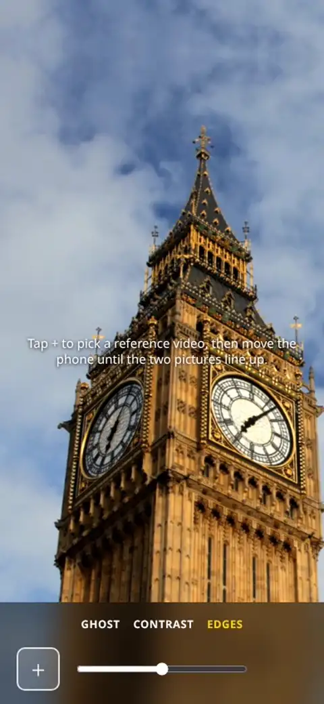

# Reshoot

Shoot a video again from the same spot. Pick the old video and Reshoot lays one of its frames over your phone camera. Move the phone until the lime lines disappear.

Open [reshoot.artems.net](https://reshoot.artems.net) on your phone. It installs to the home screen and works offline.

Edges draws the frame's outlines and hides the ones the camera already matches. Ghost overlays the frame at the opacity you set, and Contrast does the same in black and white. With an iPhone video it switches to the lens and zoom the video was shot with.

There is no build step. `public/` is the whole app and `pnpm verify` runs the browser tests.
